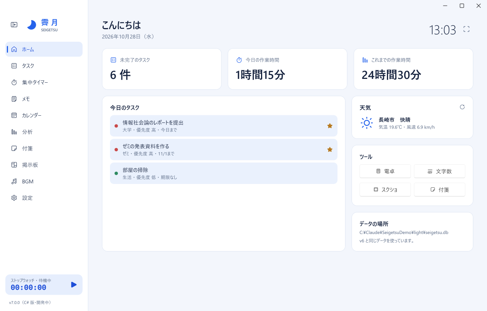
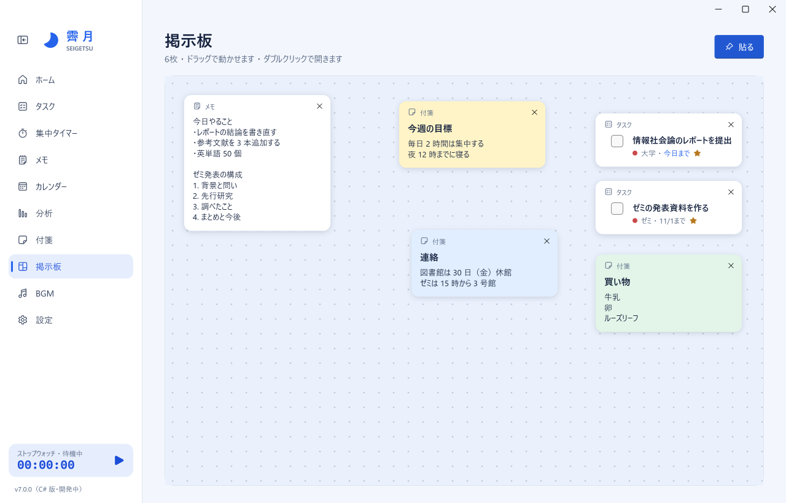
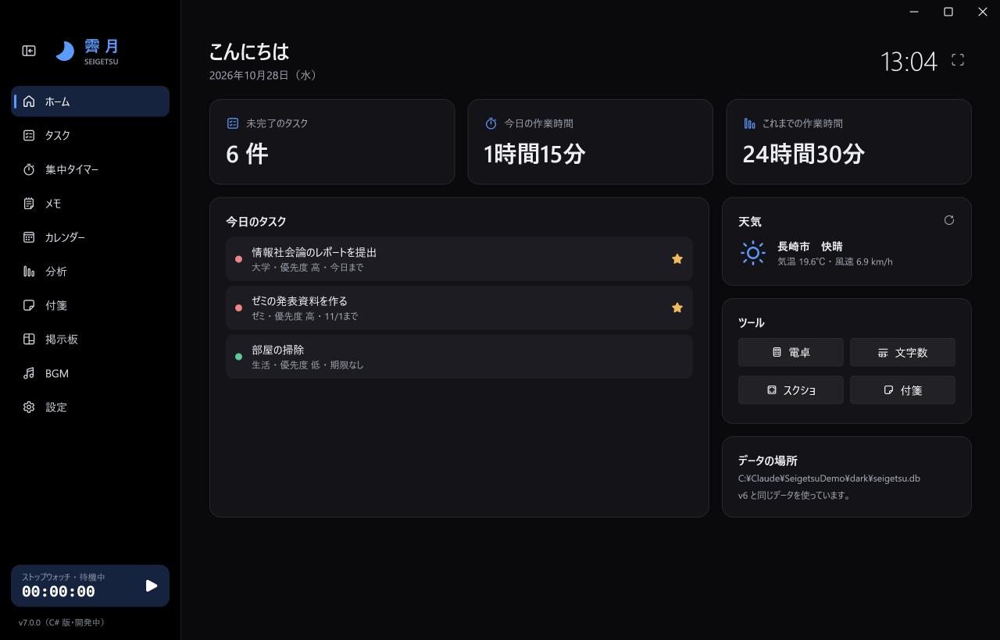

# 霽月 - Seigetsu

**勉強や作業に必要なものを、ひとつの窓に。**
タスク・集中タイマー・メモ・付箋・掲示板・BGM をまとめた、Windows 用の作業アシスタントです。

[**ダウンロード（Windows 版）**](https://github.com/Hayato-Akiduki/Seigetsu/releases/latest/download/Seigetsu-win-Setup.exe)
・ [ウェブサイト](https://hayato-akiduki.github.io/Seigetsu/)
・ [すべての版](https://github.com/Hayato-Akiduki/Seigetsu/releases)

## できること

| | |
|---|---|
| **ホーム** | 今日のタスク、今日とこれまでの作業時間、天気をひと目で。電卓・文字数カウンター・スクリーンショットもここから |
| **タスク** | 優先度・締切・カテゴリ・お気に入り。検索と絞り込み（未完了・完了・お気に入り・期限切れ）。締切が今日や過ぎたタスクは、1 日 1 回 Windows の通知で知らせます |
| **集中タイマー** | ストップウォッチとポモドーロ。計った時間は自動で記録され、ほかの画面にいても左下で動きが見えます |
| **メモ** | 何枚でも作れて、名前を付けて一覧から切り替えられます。書いたそばから自動で保存し、テキストファイルにも書き出せます |
| **カレンダー** | 締切のある日に印。日付を選んで、その日のタスクを確認・追加できます |
| **分析** | 今日・直近 7 日・今月・累計の作業時間と、週間・曜日別・月間のグラフ。CSV に書き出せます |
| **付箋** | 6 色から選べる付箋。**デスクトップに貼り出して**、壁紙の上に置いておくこともできます（ほかのアプリのじゃまをしません） |
| **掲示板** | メモ・付箋・タスクを好きな場所に貼って並べる、自分だけのボード |
| **BGM** | 手持ちの mp3 / wav / ogg を流すプレイヤー。ほかの画面に移っても流れ続けます |
| **時計の大画面表示** | `F11` で時計と動いているタイマーを画面いっぱいに |

ほかにも、明るい／暗い外観（Windows に合わせることもできます）、タスクトレイへの格納、背景画像（ホームの上帯・窓全体・時計の大画面）、ホームの上帯に名言や季節のことばを順番に出す機能、毎日の自動バックアップがあります。

## インストール

1. [**Seigetsu-win-Setup.exe**](https://github.com/Hayato-Akiduki/Seigetsu/releases/latest/download/Seigetsu-win-Setup.exe) をダウンロードして開きます。
2. 「Windows によって PC が保護されました」と出たら、**「詳細情報」→「実行」** を押してください。
   霽月にはまだコード署名がないため、初めて開くときにこの確認が出ます。
3. インストールが終わると霽月が起動し、スタートメニューとデスクトップにショートカットができます。

- 動作環境：Windows 10 / 11（64 ビット）
- 管理者の権限はいりません。.NET などをあらかじめ入れておく必要もありません。
- インストールしたくない場合は、[すべての版](https://github.com/Hayato-Akiduki/Seigetsu/releases) から `Seigetsu-win-Portable.zip` を落として、展開した中の `Seigetsu.exe` を開いても使えます。

## 自動更新

霽月は、起動しているあいだに新しい版を確認し、あれば裏でダウンロードしておきます。入れ替えは **霽月を閉じたとき** に行うので、作業の途中で止まることはありません。設定画面の「アップデート」から、すぐに更新することもできます。

## データとバックアップ

- タスクやメモなどのデータは、この PC の `%APPDATA%\akidesk` に保存されます。外のサーバーには送りません。
- 1 日 1 回、同じフォルダの `backups-v7` に自動でバックアップを取り、7 日分を残します。
- 更新やアンインストールをしてもデータは消えません。
- 設定画面の「CSVで書き出す」で、タスクと作業記録を表計算ソフトで開ける形にできます。

### ネットにつながる機能

| 機能 | 送るもの | 送り先 |
|---|---|---|
| 天気 | 設定画面で入れた地域名と、その場所の緯度・経度 | [Open-Meteo](https://open-meteo.com/)（無料の天気サービス） |
| 自動更新 | 新しい版があるかの確認 | GitHub（このリポジトリ） |

アカウントの登録はなく、上の 2 つのほかにデータを送ることはありません。

## ショートカットキー

| キー | 動き |
|---|---|
| `Ctrl` + `1`〜`9`、`0` | 画面を切り替える（ホーム・タスク・集中タイマー・メモ・カレンダー・分析・付箋・掲示板・BGM・設定の順） |
| `Ctrl` + `N` | 新しいタスク |
| `Ctrl` + `B` | 左のメニューを開く／閉じる |
| `F11` | 時計の大画面表示（`Esc` で戻る） |
| `Ctrl` + `Enter` | 付箋の入力画面で保存 |
| `Ctrl` + `Q` | 霽月を終わる（タスクトレイに格納する設定でも終わります） |

## アンインストール

Windows の「設定」→「アプリ」→「インストールされているアプリ」から **霽月** を選んで「アンインストール」を押します。
データ（`%APPDATA%\akidesk`）は残るので、消したいときはそのフォルダを削除してください。

## 以前の版（v6）を使っていた人へ

v7 は v6（Python 版）と同じデータをそのまま読み込みます。初めて v7 を起動したときに、それまでのデータを `seigetsu.db.before-v7` として一度だけ写してから使い始めるので、何かあってもこのファイルで元に戻せます。v6 と v7 を同時に開くのは避けてください。

## 困ったときは

- うまく動かないときは、`%APPDATA%\akidesk\error-v7.log` にエラーの記録が残ります。
- 不具合の報告や要望は [Issues](https://github.com/Hayato-Akiduki/Seigetsu/issues) へどうぞ。

## 使っている部品

霽月は次のオープンソースの部品を使っています（いずれも MIT ライセンス）：
[WPF-UI](https://github.com/lepoco/wpfui)、
[Microsoft.Data.Sqlite](https://github.com/dotnet/efcore)、
[NAudio](https://github.com/naudio/NAudio)、
[NAudio.Vorbis](https://github.com/naudio/Vorbis)、
[Velopack](https://github.com/velopack/velopack)。
天気のデータは [Open-Meteo](https://open-meteo.com/) によるものです。
